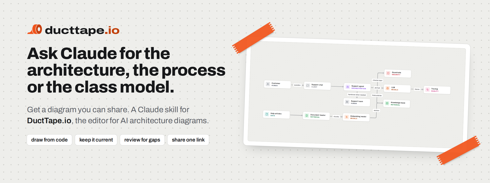
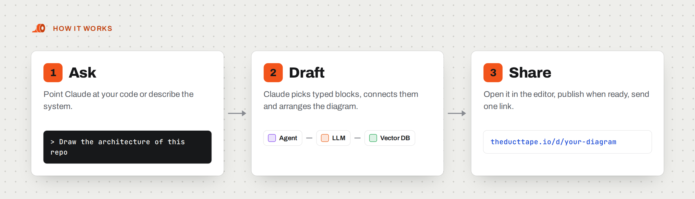
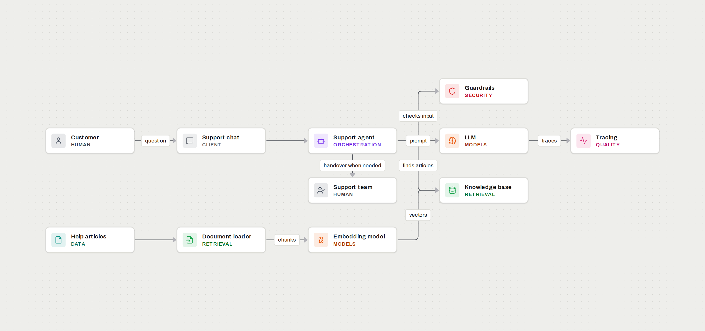
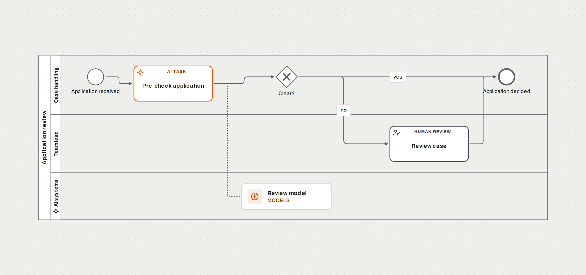
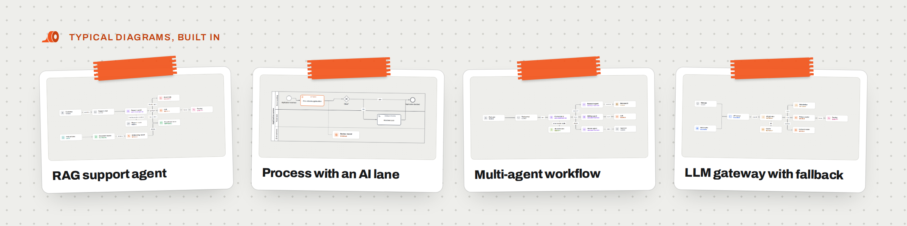

<p align="center">
  <a href="https://theducttape.io">
  <picture>
    <source media="(prefers-color-scheme: dark)" srcset="docs/banner-dark.png">
    
  </picture>
  </a>
</p>

# DuctTape.io skill for Claude

**Ask Claude for the architecture, the process or the class model. Get a diagram you can share.**

Your AI stack lives in code, in config files and in three people's heads. So does the process it serves. This skill lets Claude turn both into real diagrams on [DuctTape.io](https://theducttape.io): typed components, labelled connections, one link for everyone who needs to understand it.

Claude now draws more than architecture. It models business processes in BPMN and as event-driven process chains, the code behind them as UML class diagrams, and the decisions in DMN. All of it can sit in one diagram with the AI components that do the work.

No boxes to drag, no arrows to straighten. You describe or point at the code, Claude draws.

<p align="center">
  <picture>
    <source media="(prefers-color-scheme: dark)" srcset="docs/how-dark.png">
    
  </picture>
</p>

## What you can ask

### Architecture

**"Draw the architecture of this repository."**
Claude reads the entry points, model calls, vector stores, queues and tools, and hands you a diagram of how a request really flows.

**"We added a reranker and a fallback model. Update the diagram."**
Claude reads the existing diagram, tells you what will change, and updates the draft once you say go. The diagram stops being the thing nobody maintains.

**"Review this: what is missing?"**
A second pair of eyes for guardrails, tracing, fallbacks, auth, secrets, evals and where personal data travels. You get the gaps that matter for this system, not a generic checklist.

**"Explain this diagram to a new teammate."**
Claude walks along the path of a request, from the user to the answer.

**"Give me a starting point for a RAG with an agent on top."**
Typical architectures are built in: RAG, agents with tools, gateways with fallback. Start from one and make it yours.

### Processes, software and decisions

**"Draw our claims process in BPMN, with the agent that checks the documents in its own lane."**
Pools, lanes, events, gateways and tasks, plus an AI lane that holds the model and the agent a task uses. Human review stays a step of its own. Starter template: [Process with an AI lane](https://theducttape.io/d/vvutzEaF8Jaa).

**"Turn this onboarding process into an event-driven process chain."**
Events and functions take turns, connectors split and join the paths, and every function gets its organisational unit. The AI function is connected to the component that carries it out. Starter template: [Incoming invoices with an AI function](https://theducttape.io/d/crqpe4OXQR9Q).

**"Draw the classes of this module as a UML class diagram."**
Classes, interfaces and enumerations with their attributes and operations, inheritance, composition and multiplicities. A class that stands for a model or a vector store keeps its AI category. Starter template: [RAG module as a class diagram](https://theducttape.io/d/nJ5YZYM43wHN).

**"Model the credit decision in DMN, with the decision table."**
Decisions, input data, knowledge sources and business knowledge models, a decision table with its hit policy, and the AI decision connected to the model that takes it. Starter template: [Refund decision with AI](https://theducttape.io/d/fVbygzgBQSD5).

**"Here is our Mermaid flowchart from the docs. Make it a diagram."**
Claude imports Mermaid flowcharts, architecture diagrams and class diagrams and matches the labels against the catalog. The way back works too: export to Mermaid, edit the text, and update the diagram in the editor without losing positions.

**"Give me one overview, and let each service open its own diagram."**
A component, a group, a BPMN task, an EPC function or a DMN decision can point to another of your diagrams. One click on the mark opens the detail.

**"Put the old drafts from the hackathon into the archive."**
Claude moves diagrams to the archive or the trash and brings them back, only when you ask and after it has named the diagrams it means. Deleting for good stays in the app.

## What comes out

<p align="center">
  <a href="https://theducttape.io/d/HNnyikUTbawl">
  <picture>
    <source media="(prefers-color-scheme: dark)" srcset="docs/rag-support-agent-dark.png">
    
  </picture>
  </a>
</p>

<p align="center">
  <a href="https://theducttape.io/d/vvutzEaF8Jaa">
  <picture>
    <source media="(prefers-color-scheme: dark)" srcset="docs/process-ai-lane-dark.png">
    
  </picture>
  </a>
</p>

<p align="center"><sub>Real results. Click one to open the interactive diagram.</sub></p>

- **A diagram that knows what it shows.** Typed components from LLM, vector DB and agent to MCP server, guardrails and human in the loop, and the shapes of BPMN, EPC, UML and DMN. Every component knows what it is, so diagrams stay consistent and readable.
- **A check that knows the notation.** DuctTape.io checks every diagram and gives notes, never errors: a component nothing leads to, a BPMN pool without an end event, an EPC function without its unit, an AI task with no model behind it. Claude fixes what the notes point at.
- **Your vendors, where they belong.** The catalog knows the vendors of the AI stack. Claude names one only where your system really uses it.
- **A link into the editor.** Move things around, add detail, change your mind. It is your diagram.
- **Text formats for your docs.** Claude exports a diagram as Mermaid, as D2, or as a Markdown or AsciiDoc document with the diagram as code and tables of its components and connections. In the editor you also export PDF, PNG, SVG, BPMN 2.0 and DMN files.
- **One fixed link to share.** Publish when you are ready. Whoever opens the link needs no account, and the same link shows the new version whenever you publish an update.

## Two ways to work

| | With a connection | Without |
|---|---|---|
| Setup | An access token and one command | None |
| What Claude does | Creates and updates drafts right in your account, imports Mermaid, exports text formats, files diagrams in the archive or trash on request | Writes a diagram file |
| What you get | A link to the editor | A file for "Import from JSON" |

Either way Claude works on drafts. Publishing and deleting for good stay with you.

Over the connection, BPMN, EPC, UML and DMN each come with a licence on your account. New accounts start with all of them. Without a connection the script writes the file for every notation, and the editor opens it.

## Install in two minutes

### Claude Code

```sh
git clone https://github.com/DuctTape-io/ducttape-skill.git
mkdir -p ~/.claude/skills
cp -r ducttape-skill/skills/ducttape ~/.claude/skills/
```

That is it. Claude picks the skill up as soon as a diagram comes up.

### Claude app

Download `ducttape-skill.zip` from the [latest release](https://github.com/DuctTape-io/ducttape-skill/releases/latest) and upload it in the settings, in the skills section. Skills need code execution there.

### Connect your account (optional, recommended)

Create an access token in the [settings](https://theducttape.io/app/settings) of your free DuctTape.io account, then:

```sh
claude mcp add --transport http ducttape https://theducttape.io/api/mcp --header "Authorization: Bearer dtp_..."
```

From now on "draw this" ends with a link instead of a file. The full guide is at [theducttape.io/claude-skill](https://theducttape.io/claude-skill).

## What is inside

| Path | Content |
|---|---|
| `skills/ducttape/SKILL.md` | Workflows, the notations (BPMN, EPC, UML, DMN), Mermaid and the other exports, links between diagrams, limits |
| `skills/ducttape/reference/modelling.md` | Which component for what, how to label connections, typical architectures, the review checklist |
| `skills/ducttape/reference/catalog.json` | Component kinds, vendors and the shapes of every notation, generated from the app's own catalog |
| `skills/ducttape/scripts/prepare-diagram.mjs` | Checks a diagram file and arranges it, each notation in its own way. Node.js 18 or later, no dependencies |

The script also works on its own:

```sh
node skills/ducttape/scripts/prepare-diagram.mjs graph.json "My diagram.json"
```

`graph.json` holds `{ "nodes": [{ "id", "kind", "label"? }], "edges": [{ "source", "target", "label"? }] }`.

## See what a result looks like

<p align="center">
  <a href="https://theducttape.io/examples">
  <picture>
    <source media="(prefers-color-scheme: dark)" srcset="docs/gallery-dark.png">
    
  </picture>
  </a>
</p>

Reference architectures as interactive diagrams: [theducttape.io/examples](https://theducttape.io/examples).

## Versions and license

The version is in the front matter of `SKILL.md`. This repository mirrors the skill that ships with the app; changes are made there and published here.

[MIT](LICENSE), copyright TheDuctTape.io. Vendor names in the catalog are trademarks of their respective owners. BPMN, UML and DMN are trademarks of the Object Management Group; the names only describe the standards these shapes represent, and DuctTape.io is not affiliated with, reviewed or certified by the Object Management Group.
